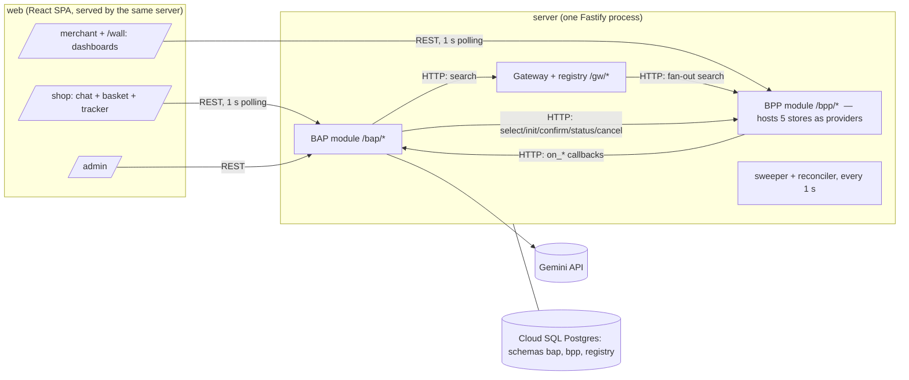
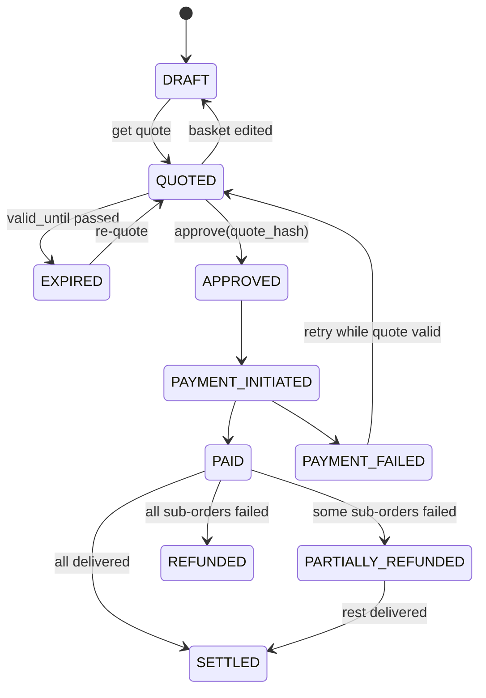

# KiranaAI — Product Requirements Document v2.1 (Hackathon MVP)

Agentic commerce for neighbourhood kirana stores, built on Beckn / ONDC.

| Field | Value |
|---|---|
| Product type | AI-powered, multi-merchant commerce platform (hackathon MVP) |
| Primary market | Neighbourhood kirana stores in India |
| Interoperability target | Beckn request/callback, aligned to ONDC Retail API contract v1.2.x, domain `ONDC:RET10` (grocery) |
| Version | 2.1 (refines v2.0, 16 Oct 2026) |
| Date | 18 October 2026 |
| Build window | 24–48 hours |
| Demo format | **Hosted on Google Cloud** (Cloud Run + Cloud SQL + Gemini API) with a public URL for judges; local `docker compose` fallback |
| Stack | TypeScript end to end; Gemini for the agent |

---

## 0. What changed from v2.0

v2.0 had the right product scope. v2.1 makes it buildable in a hackathon and hostable at one URL.

| # | Change | Why |
|---|---|---|
| 1 | **One deployable server** with three modules (gateway, BAP, BPP) on separate route prefixes. They talk to each other over **real HTTP Beckn calls** (the server calls itself at `SELF_BASE_URL`, i.e. `http://127.0.0.1:$PORT` on Cloud Run). | Four deployables are too many for 48 h and harder to host. Real HTTP between modules keeps the Beckn flow genuine and visible in the audit log. |
| 2 | **One Postgres database, two schemas** (`bap`, `bpp`) plus `registry`. Modules never query another module's schema. | Keeps buyer/seller separation without running extra databases. |
| 3 | **No Redis.** Offer timers and atomic claims use Postgres (`expires_at` column + conditional `UPDATE`). | Same guarantees, restart-safe, one less hosted service. |
| 4 | **Polling (1 s) instead of SSE/WebSockets** for live screens. | Works behind every hosting proxy with no buffering surprises; fast enough for a demo. |
| 5 | **Split "sub-order" into Sub-order (customer-facing) and Attempt (one per store offer).** Each attempt is its own Beckn order. | In Beckn an order belongs to one provider; reassignment means a new order. |
| 6 | **Ownership split for dispatch.** BPP owns one attempt (timer, claim, expiry). BAP owns reassignment (next store, attempt cap, refund). | Avoids two timers that disagree. |
| 7 | **Settlement formula fixed.** Platform fee is paid by the customer and kept by the platform; merchant commission is separate (default 0); reassignment subsidy is its own ledger line. | v2.0 deducted the fee from the merchant as well, charging it twice. |
| 8 | **Equivalence by canonical product ID** (same GTIN, or same brand + variant + pack size). | Needed to decide whether another store can take over a sub-order. |
| 9 | **Seed data is designed for the demo** (exactly 3 stores chosen; backups exist). | A cost-minimising optimiser would otherwise put everything in one store. |
| 10 | **The agent cannot pay.** Payment needs a single-use approval token minted only by the UI's Approve button. | Enforces AGT-07 in code. |
| 11 | **Basket optimisation is deterministic code**, not LLM reasoning; the LLM explains its output. | Reliable, fast, and the explanations are grounded. |
| 12 | **Demo wall:** one page showing all 5 merchant dashboards side by side. | A presenter (or a judge alone) can drive the whole scenario from one screen. |
| 13 | **Money in integer paise; quantities are integer pack counts.** | No rounding bugs. |
| 14 | **Google Cloud hosting** (§13.1): Cloud Run (always-on, single instance), Cloud SQL Postgres, Gemini API (key from Google AI Studio, stored in Secret Manager), Cloud Logging. Admin passcode and LLM rate limit. | Judges get a URL that works unattended; the key never reaches the browser; everything in one Google project. |
| 15 | Open questions resolved (§16). | Removes blockers. |

### 0.1 Hosting change (18 Oct 2026, after v2.1)

Decided to cut cost; supersedes the Cloud SQL / `asia-south1` / always-on wording in §4.2 and §13.1.

| Was | Now | Consequence |
|---|---|---|
| Cloud SQL Postgres 16 (`kiranaai-pg`) | Postgres 16 on an **Always Free e2-micro VM** `kiranaai-db` (us-central1-a, pd-standard 20 GB, no external IP), reached on its internal IP via Cloud Run **Direct VPC egress**; connection by TCP (`DB_HOST`), not the Cloud SQL socket | No managed backups (demo reseeds). Firewall allows 5432 from the VPC only. |
| Region `asia-south1` | **`us-central1`** for Cloud Run and the VM (free tier exists only in US regions) | ~250 ms extra per browser request from India; DB queries stay in-region. |
| Cloud Run min 1 / max 1, `--no-cpu-throttling` | **min 0 / max 1**, request-based CPU (scale to zero) | Cold start on first visit. The 1 s sweeper/reconciler cannot rely on a timer between requests: jobs run on boot, on a 1 s interval, **and from an `onRequest` hook when overdue** (`apps/server/src/lib/ticker.ts`). Live screens poll every second, so expiry stays within ~1 s while anyone is watching. |

---

## 1. Vision and MVP definition

KiranaAI lets kirana stores put their packaged-goods catalogues online so AI shopping agents can find and buy from them. A customer describes a need in plain language; the agent finds products across nearby stores, builds a basket, gets verified quotes and shows one total. The customer approves and pays once. The platform sends a timed offer to each store, ride-hailing style, and reassigns automatically if a store rejects or doesn't respond.

### 1.1 The MVP is done when, on the hosted URL, with no manual database edits:

1. A natural-language request produces a multi-store basket (3 stores) with a reason for each choice.
2. Fresh quotes via Beckn `select`/`init` produce one itemised total split by store.
3. Explicit approval leads to one simulated payment.
4. Three timed offers appear on three merchant dashboards with a countdown and sound.
5. One store accepts, one rejects, one times out; both failed offers are reassigned automatically and accepted.
6. The customer tracker shows dispatch progress, then fulfilment to delivered, with payment status shown separately.
7. The settlement ledger shows each merchant's share, including any platform subsidy.
8. The agent declines "250 g jeera" and suggests a packaged alternative.
9. A merchant adds a product (form or CSV) and it becomes searchable.

### 1.2 Scope decisions (unchanged from v2.0)

Packaged items only; one customer payment split per merchant; the store delivers; sequential timed offers with up to 3 attempts; Beckn/ONDC-aligned, not compliant.

---

## 2. Users and roles

| Role | Key needs | MVP login |
|---|---|---|
| Customer | Fast basket, one price, one payment, clear status | Persona picker → signed demo token (role `customer`) |
| Merchant | Easy catalogue, loud timely offers, delivery workflow, payouts | Persona picker → token scoped to one `store_id` |
| AI shopping agent | Verified data only, bounded authority | Runs inside the BAP with the customer's token; has no payment tool |
| Platform operator | Reset, config, failure injection, audit | Admin page behind a passcode (env var) |

No sign-up, passwords or OTP login.

---

## 3. Success criteria

| Goal | Measurable criterion |
|---|---|
| Digitise stores | Merchant adds a product in the UI, or imports a CSV; invalid rows are listed with reasons; new items are searchable at once. |
| AI discovery | "atta" and "gehun ka aata" both return matches from ≥ 3 stores. |
| Intelligent shopping | The demo prompt yields 4 items across exactly 3 stores, under ₹1,500, with one reason per item. |
| Transaction accuracy | A price changed by the merchant after search shows up in the quote, highlighted. |
| Complete the loop | One payment, one sub-order per store, one attempt per offer, ledger entries per merchant. |
| Resilient dispatch | Next offer is live within 2 s of a reject/expiry; accepting an expired offer is refused. |
| Merchant value | Each store moves its order to DELIVERED from its own dashboard. |
| Protocol alignment | Audit log shows `search`, `select`, `init`, `confirm`, `status`, `cancel` and their `on_*` callbacks under one `transaction_id`. |
| Hosted | Judges can open the URL cold and complete the demo; first page load < 3 s. |

Priorities: **P0** required for the demo; **P1** if time permits; **P2** future.

---

## 4. Architecture

### 4.1 Components

| Module | Owns |
|---|---|
| **BAP** | Customers, baskets, quote snapshots, approval, simulated payment, refunds, ledger, **sub-orders and reassignment**, agent and tools. |
| **BPP** (multi-provider) | Stores, catalogue, stock, prices, delivery rules, **attempt orders with offer timer and atomic claim**, fulfilment states, CSV import. |
| **Gateway + registry** | Participant table, `lookup`, `search` fan-out to every registered BPP. |
| **Web** | One React SPA: `/` persona picker, `/shop`, `/shop/orders/:id`, `/merchant`, `/wall`, `/admin`. |

The registry can hold more than one BPP. The MVP registers one BPP hosting 5 providers; a second BPP base path (`/bpp2`, same code, different store set) is a P1 to make fan-out visible.

### 4.2 Tech stack

| Layer | Choice | Rationale |
|---|---|---|
| Language | TypeScript, Node 22 LTS | One language; Beckn types shared with the UI |
| Repo | pnpm workspaces: `apps/server`, `apps/web`, `packages/shared` | Minimal structure |
| Server | Fastify + zod | Validated payloads, fast to write |
| DB | Postgres 16, Drizzle ORM + drizzle-kit; `pg_trgm` for fuzzy search | Raw SQL where it matters (claims, search) |
| Timers | In-process 1 s interval over Postgres | Restart-safe; no queue |
| Live updates | TanStack Query polling (1 s on live screens) | Proxy-proof on any host |
| LLM | **Gemini API** via `@google/genai` with `GEMINI_API_KEY` (key created in Google AI Studio and linked to the project; optionally restricted to the Generative Language API in Cloud Console), function calling. Model: a **Flash** model set by `GEMINI_MODEL` (default **`gemini-3.5-flash-lite`** since 18 Oct 2026: the free-tier `gemini-3.5-flash` quota ran out, and Flash Lite passed the agent e2e with ~1.5 s per tool call and ~10 s for the demo turn. Earlier measurements for `gemini-3.5-flash`: measured ~2 s for a simple reply and ~3 s for a turn with two parallel tool calls on 18 Oct 2026; `gemini-3.8-flash` took 80–100+ s per reply and `gemini-2.5-flash` is retired for new keys). Gemini 3 returns `thoughtSignature` on parts; send model turns back unchanged in history so multi-step tool calling keeps working. | Flash is fast and cheap, and enough for tool calling over a small catalogue |
| Web | Vite + React + Tailwind + TanStack Query | Quick to build |
| Tests | Vitest + one API-level `e2e-demo.ts` script | The demo script is the regression test |
| Compute | **Cloud Run**, one service in `asia-south1` (Mumbai); min 1 / max 1 instance; CPU always allocated (`--no-cpu-throttling`) so the 1 s sweeper runs between requests. The same container serves the API and the web app. | HTTPS URL, no cold starts, close to Indian users |
| Database | **Cloud SQL for PostgreSQL 16**, smallest shared-core tier, `pg_trgm` enabled; connected through the Cloud SQL Unix socket | Managed Postgres; keeps SQL claims and search |
| Build | `gcloud run deploy --source .` → Cloud Build → Artifact Registry | One-command deploy |
| Secrets | Secret Manager (DB password, admin passcode) mounted as env vars | Nothing secret in the repo |
| Logs | Cloud Logging (pino JSON → structured logs, `transaction_id` as a label) | Second audit view; debugging on the day |
| Maps (P1) | Maps JavaScript API + Places Autocomplete for addresses; map pin on offer cards | Real geocoding for serviceability |
| Local | `docker compose up` (server + postgres); same `GEMINI_API_KEY` in a git-ignored `.env` | Fallback if venue Wi-Fi fails |

### 4.3 Identifiers and money

- `transaction_id`: one per basket checkout, reused for all Beckn calls including reassignment.
- `message_id`: unique per request, echoed in the callback; used for idempotency.
- IDs: ULIDs with prefixes `bsk_`, `sub_`, `att_` (also the Beckn `order.id`), `pay_`, `rfd_`, `led_`.
- Money: integer **paise** internally; Beckn payloads use rupee strings per ONDC, converted at the edge; UI formats.

---

## 5. Domain model

**`bpp` schema**
- `store` (provider): name, address, lat/lng, hours, phone, `delivery_radius_m`, `delivery_rule` JSON (`flat` | `distance_bands` | `free_above`), `is_online`.
- `canonical_product`: gtin?, brand, name, variant, pack_size, unit (`g|kg|ml|l|pcs`), category, search_text.
- `listing`: store, canonical_product, price_paise, mrp_paise, stock_qty (int), active.
- `synonym` (term → normalised term), `loose_term` (term → packaged alternative hint).
- `attempt_order` + `attempt_order_item`: id (= Beckn order id), store, items, quoted totals, buyer name/phone/address, `status`, `offered_at`, `expires_at`, `decided_at`, `fulfilment_status`, `reject_reason`.
- `fault` (failure injection per store: `auto_reject`, `never_answer`).

**`bap` schema**
- `customer`; `basket` (state per §7.1); `basket_item` (listing, store, canonical, qty).
- `quote` (per basket, `valid_until`, `quote_hash`, grand total, platform fee) + `quote_store` (per store breakdown).
- `approval` (single-use token); `payment` (unique per basket, `idempotency_key`).
- `sub_order` (store group, locked items and approved amount, status per §7.2, `attempt_count`, `excluded_store_ids`).
- `attempt` (sub_order, store, status per §7.3, store's own quoted total).
- `refund`, `ledger_entry`, `config` (offer window, platform fee, commission %, fail-next-payment flag), `agent_message`.

**Shared**: `audit_log` (every Beckn message in/out and every state change, with `transaction_id`), `beckn_message` (dedupe by `message_id + action`).

---

## 6. Functional requirements

Changes from v2.0 are marked **[chg]** / **[new]**.

### A. Merchant onboarding and catalogue

| ID | Requirement | P |
|---|---|---|
| MER-01 | Store profile with name, address, location, hours, phone, radius, delivery rule. **[chg]** Seeded for the 5 demo stores; an edit form is enough (no new-store sign-up flow). | P0 |
| MER-02 | Create, edit and deactivate products. A product is created by choosing an existing canonical product (or entering a new one), then setting price and stock. | P0 |
| MER-03 | Listing fields: name, brand, category, pack size, unit, price, MRP, GTIN if known, integer stock, store ID. | P0 |
| MER-04 | Inline price and stock edit. | P0 |
| MER-05 | CSV import using a fixed template; per-row validation report; valid rows applied in one transaction. | P0 |
| MER-06 | Online/offline toggle; offers only go to online stores. Going online is a click, which also unlocks browser audio. | P0 |
| MER-07 | Offer card with items, amount, distance, countdown, looping sound, Accept / Reject with reason. | P0 |
| MER-08 | Advance accepted orders: PREPARING → READY → OUT_FOR_DELIVERY → DELIVERED. | P0 |
| MER-09/10 | Invoice/shelf photo → product rows using Gemini vision (structured JSON output), then a review-and-edit screen before publishing. | P1 **[chg]** |
| MER-11 | Fallback alert channel (WhatsApp/SMS). | P2 **[chg]** |
| MER-12 | Merchant's own ledger view. | P1 |
| MER-13 **[new]** | Demo wall: `/wall` renders all 5 store dashboards in a grid, each fully interactive. | P0 |

### B. Product discovery

| ID | Requirement | P |
|---|---|---|
| DIS-01 | Natural-language search via the agent; keyword search in manual mode. | P0 |
| DIS-02 | Synonym expansion (Hinglish, Devanagari) + Postgres full-text + trigram similarity. | P0 |
| DIS-03 | Filter by serviceability (haversine ≤ radius), in-stock, optional price/category. | P0 |
| DIS-04 | Each result: store, distance, price, pack size, "catalogue stock" badge, store's delivery charge for this customer. | P0 |
| DIS-05 | Results grouped by canonical product for side-by-side comparison. | P0 |
| DIS-06 | Loose requests (loose-term match, or a g/kg amount with no matching pack) are declined with a reason and the nearest packaged alternative. | P0 |
| DIS-07 | Missing-item alternatives. | P1 |
| DIS-08 | Ranking with acceptance rate. | P2 |
| DIS-09 **[new]** | Customer address picked with Google Places Autocomplete; lat/lng from Places is used for serviceability. | P1 |

### C. AI shopping agent

| ID | Requirement | P |
|---|---|---|
| AGT-01 | Mission in natural language (English or Hinglish). | P0 |
| AGT-02 | Extract items, integer quantities, budget, preferences; address defaults to the profile. Inferred quantities are shown as editable proposals. | P0 |
| AGT-03 | Only uses tools (§12); never invents products, prices, stock or status. | P0 |
| AGT-04 | Builds the basket from tool results. | P0 |
| AGT-05 | States totals only from `get_quote`. | P0 |
| AGT-06 | One-line reason per item and store, taken from `plan_basket` output. | P0 |
| AGT-07 | Cannot order or pay; `request_approval` only shows the approval card. | P0 |
| AGT-08 | States status only from `get_order_status`. | P0 |
| AGT-09 | Clarifying questions. | P1 |
| AGT-10 | Cross-store optimisation of items vs delivery cost via deterministic `plan_basket`. **[chg]** P0 (demo depends on it). | P0 |
| AGT-11 | Substitutions. | P1 |
| AGT-12 **[new]** | If the LLM fails or exceeds 20 s, the UI says so and the manual search/basket flow works fully. | P0 |
| AGT-13 **[new]** | Voice input: customer records a request in Hindi/Hinglish/English; the audio is sent to Gemini (multimodal input) and handled like a typed message. | P1 |

### D. Basket, quote, checkout, payment

| ID | Requirement | P |
|---|---|---|
| CHK-01 | Inspect, add, remove, change integer quantities. | P0 |
| CHK-02 | Quote = parallel `select` then `init` per store; verified price, stock, delivery; validity 10 min; changes since search highlighted. | P0 |
| CHK-03 | Per-store subtotal + delivery, platform fee line, one grand total. | P0 |
| CHK-04 | Approval binds to `quote_hash`; a changed or expired quote needs re-quoting. | P0 |
| CHK-05 | Simulated payment (~1 s); failure via admin flag or "simulate failure" checkbox. | P0 |
| CHK-06 | `confirm` sent only after PAID. | P0 |
| CHK-07 | Pay is idempotent (`Idempotency-Key` + one payment per basket). | P0 |
| CHK-08 | Soft stock holds. | P2 **[chg]** |
| CHK-09 | Real payments. | P2 |

### E. Dispatch and reassignment

| ID | Requirement | P |
|---|---|---|
| DSP-01 | Each attempt has `expires_at`; window configurable (demo default 45 s, production 120 s). | P0 |
| DSP-02 | Attempt 1 goes to the approved store; later attempts to ranked eligible stores (§8). | P0 |
| DSP-03 | Accept is an atomic conditional `UPDATE`; otherwise `409 OFFER_NOT_AVAILABLE`. | P0 |
| DSP-04 | Reject or expiry → next attempt; max 3 per sub-order. | P0 |
| DSP-05 | Customer's approved amount honoured; new store paid its own quote; difference is platform subsidy. | P0 |
| DSP-06 | Exhausted → FAILED_NO_FULFILMENT, refund of that sub-order's share. | P0 |
| DSP-07 | Tracker shows store, attempt n/3, countdown, outcome. | P0 |
| DSP-08 | Acceptance-rate ranking. | P2 |
| DSP-09 | Customer cancel during dispatch. | P1 |
| DSP-10 | Broadcast mode. | P2 |

### F. Orders, delivery, settlement

| ID | Requirement | P |
|---|---|---|
| ORD-01 | Unique basket, sub-order and attempt IDs. | P0 |
| ORD-02 | Attempt order carries only store, items, prices, delivery charge, address, name, phone. | P0 |
| ORD-03 | Payment status (basket) and fulfilment status (sub-order) are separate fields and separate badges. | P0 |
| ORD-04 | Live status via 1 s polling. | P0 |
| ORD-05 | Ledger per delivered sub-order (§9). | P0 |
| ORD-06 | Delivery OTP. | P1 |
| ORD-07 | Returns, post-acceptance cancellations. | P2 |

### G. Beckn / ONDC

| ID | Requirement | P |
|---|---|---|
| BKN-01 | `search`, `select`, `init`, `confirm`, `status`, `cancel` + `on_*` callbacks over HTTP with synchronous ACK. BPP sends unsolicited `on_status` and `on_cancel`. | P0 |
| BKN-02 | Payload shapes follow ONDC Retail v1.2.x for the fields we use (zod schemas in `packages/shared/beckn`). Deviations in `docs/ONDC_DEVIATIONS.md`. | P0 |
| BKN-03 | Local registry + gateway fan-out. | P0 |
| BKN-04 | Reject/timeout → unsolicited `on_cancel` with reason; reassignment → `search`/`select`/`init`/`confirm` to the next provider, same `transaction_id`. | P0 |
| BKN-05 | `transaction_id` / `message_id` for tracing and dedupe. | P0 |
| BKN-06 | Docs list unsupported capabilities and do not claim compliance. | P0 |
| BKN-07 | Second BPP instance in the registry. | P1 **[new]** |
| BKN-08 | ONDC staging, IGM, RSF. | P2 |

---

## 7. State machines

### 7.1 Basket (BAP)

### 7.2 Sub-order (BAP, customer-facing)

DISPATCHING → ACCEPTED → PREPARING → READY → OUT_FOR_DELIVERY → DELIVERED; or DISPATCHING → FAILED_NO_FULFILMENT (refund). States after ACCEPTED mirror the BPP's `on_status`.

### 7.3 Attempt (BPP owns; BAP mirrors)

OFFERED → ACCEPTED | REJECTED | EXPIRED. REJECTED and EXPIRED are terminal; the BAP decides what happens next.

**Beckn mapping:** OFFERED = order `Created`; ACCEPTED = `Accepted`; PREPARING/READY/OUT_FOR_DELIVERY = `In-progress` with fulfilment `Pending` / `Packed` / `Out-for-delivery`; DELIVERED = `Completed` + `Order-delivered`; REJECTED/EXPIRED = `Cancelled` via `on_cancel`.

---

## 8. Dispatch and reassignment rules

1. **Eligibility** (attempt > 1): online, within hours, customer in radius, stocks every canonical item at the needed quantity, not excluded.
2. **Candidates:** BAP sends `search` through the gateway with the sub-order's canonical IDs in a tag (documented deviation). Rank by full coverage (required) → store's total incl. delivery → distance.
3. **Next attempt:** `select` → `init` → `confirm` to the top candidate under the same `transaction_id`; if `on_select` shows it can't cover the items, try the next candidate (doesn't use up an attempt).
4. **Timer:** `expires_at = offered_at + window`. Sweeper each second: `UPDATE … SET status='EXPIRED' WHERE status='OFFERED' AND expires_at <= now() RETURNING …`, then send `on_cancel` for each row.
5. **Atomic claim:** `UPDATE … SET status='ACCEPTED' WHERE id=$1 AND store_id=$2 AND status='OFFERED' AND expires_at > now() RETURNING id`; no row → 409.
6. **Exclusion** of stores that rejected or timed out, per sub-order.
7. **Attempt cap** 3 → FAILED_NO_FULFILMENT + refund.
8. **Price protection** (§9).
9. **Restart safety:** all state in Postgres. On boot the sweeper expires overdue offers, and a reconciler starts the next attempt for any DISPATCHING sub-order with no open attempt. Handlers dedupe by `message_id` and ignore repeat transitions. Per-sub-order Postgres advisory lock prevents double reassignment.
10. **Latency:** next offer live < 2 s after reject/expiry.
11. **Failure injection:** per-store `auto_reject` (rejects ~3 s after offer) and `never_answer` (merchant UI hides Accept, so it times out).

---

## 9. Payments, pricing, settlement

- **Customer pays** Σ(items + delivery per store) + platform fee (flat per basket, default ₹0).
- **Refund** per failed sub-order = its items + its delivery + platform fee × its share of items total (last refund takes the rounding remainder).
- **Ledger entry** per delivered sub-order: `gross` = accepting store's own items + delivery; `commission` = gross × % (default 0); `net_payable` = gross − commission; `platform_subsidy` = gross − customer-approved amount for that sub-order (negative means platform gain).
- **SETTLED** when every sub-order is DELIVERED or FAILED + refunded.

**Worked example (fee 0, commission 0)**

| Sub-order | Approved | Outcome | Paid to | Net | Subsidy |
|---|---|---|---|---|---|
| S1 atta | Sharma ₹450 + ₹20 = ₹470 | Accepted | Sharma | ₹470 | ₹0 |
| S2 dal + tea | Gupta ₹380 + ₹0 = ₹380 | Timed out → Balaji ₹395 + ₹25 | Balaji | ₹420 | ₹40 |
| S3 milk | Lakshmi ₹520 + ₹30 = ₹550 | Rejected → Annapurna ₹540 + ₹10 | Annapurna | ₹550 | ₹0 |
| **Total** | **₹1,400 paid** | | | **₹1,440** | **₹40** |

---

## 10. Delivery

Store delivers. Rules: `flat`, `distance_bands`, `free_above`. Serviceability checked at search and again at quote. Delivery OTP is P1.

---

## 11. Beckn flow for one basket

| Step | Calls | Notes |
|---|---|---|
| Discover | `search` → gateway → BPP(s) → `on_search` | BAP collects callbacks for 1.5 s then returns. |
| Validate | `select` / `on_select` per store, in parallel | Verified price, stock, delivery. |
| Prepare | `init` / `on_init` per store | Final quote + `ttl`; BAP stores snapshot and `quote_hash`. |
| Approve + pay | BAP only | Approval token → simulated payment. |
| Dispatch | `confirm` / `on_confirm` per store | BPP creates attempt order (OFFERED), starts timer. |
| Accept/reject | unsolicited `on_status` (Accepted) / `on_cancel` (rejected or timeout) | |
| Reassign | `search` (canonical filter) → `select` → `init` → `confirm` | Same `transaction_id`, new `order.id`. |
| Track | unsolicited `on_status` per fulfilment change | |

**Synchronous wrapper:** BAP sends a request, gets ACK, then awaits an in-memory waiter keyed by `message_id` (select/init 5 s). Callbacks are also persisted. The server calls itself over HTTP at `SELF_BASE_URL` (`http://127.0.0.1:$PORT`), so the same code works locally and on Cloud Run, and callbacks always reach the instance holding the waiter.

**Not implemented (documented):** signing and auth headers, `/subscribe`, ONDC log verification, IGM, RSF, `update`, rating, support. *ONDC-aligned, not ONDC-compliant.*

---

## 12. Agent design (Gemini)

`POST /bap/agent/chat` takes the user message, runs a Gemini function-calling loop server-side, and returns the final text plus a list of UI events (basket changed, quote ready, approval requested). Conversation history is stored per customer. Responses are not streamed; the UI shows a "thinking…" state with the tool steps as they finish (polled, P1) or after the turn completes (P0).

| Tool | Does | Guardrail |
|---|---|---|
| `search_products(query, max_price?)` | Beckn search via gateway | May return `loose_declined` with alternatives |
| `plan_basket(needs[{query, qty}], budget?)` | Deterministic optimiser | Returns choices, estimate, reasons; integer qty only |
| `set_basket(items[{listing_id, qty}])`, `update_item`, `remove_item`, `view_basket` | Basket CRUD | Integer qty ≥ 1 enforced |
| `get_quote()` | select + init for all stores | Only source of totals |
| `request_approval()` | Shows the approval card | Returns `awaiting_customer`; cannot pay |
| `get_order_status()` | Reads BAP state | Only source of status |

**In code:** no pay/confirm tool exists; `POST /bap/baskets/:id/pay` requires a single-use token from `POST /bap/baskets/:id/approve`, which only the UI button calls. Totals on screen always come from API data, not the agent's text. Max 8 tool calls per turn; 20 s timeout → AGT-12 fallback.

**Optimiser:** exact search over store subsets (5 stores → 31 subsets). Cost = Σ cheapest item price in the subset + Σ delivery charges of stores used. Cheapest wins; ties go to fewer stores, then to the smaller total store distance (needed because the §9 worked example makes Sharma+Gupta+Annapurna cost the same ₹1,400 as Sharma+Gupta+Lakshmi; Lakshmi is nearer). A need's candidates are the offers of its matching canonical products; the cheapest offer per need within the subset is used. Seed stores start **online** so the hosted URL works cold; "All stores online" on the wall mainly unlocks audio. Reasons are generated from the numbers ("₹12 cheaper than Gupta", "adding Lakshmi saves ₹38 even after ₹30 delivery").

---

## 13. Non-functional requirements

| Area | Requirement |
|---|---|
| Security | Merchant token scoped to `store_id` on every BPP merchant route; customers see only their baskets; admin behind passcode. |
| Integrity | All prices, stock, delivery and totals recomputed server-side at quote; client numbers ignored. |
| Idempotency | Pay, confirm, accept and all `on_*` handlers. |
| Privacy | Merchant sees name, phone, address, items only; phone masked until accepted. |
| Transparency | "catalogue stock" vs "verified" badges. |
| Responsiveness | Search < 2 s (excluding LLM); next offer < 2 s after reject/expiry. |
| Auditability | Every Beckn message and state change in `audit_log`, viewable per `transaction_id`. |
| AI safety | §12 guardrails. |
| Operability | Admin: reset & reseed, offer window, fail-next-payment, per-store fault toggles. |

### 13.1 Hosting

**Google Cloud layout (one project, region `asia-south1`):**

| Service | Use |
|---|---|
| Cloud Run `kiranaai` | The single container; public, unauthenticated; min = max = 1 instance; CPU always allocated |
| Cloud SQL `kiranaai-pg` | Postgres 16, smallest shared-core tier, private to the service via the Cloud SQL connector |
| Gemini API (Generative Language API) | Agent calls, using an API key restricted to this API |
| Secret Manager | `db-password`, `admin-passcode`, `gemini-api-key` |
| Cloud Build + Artifact Registry | Builds the image from `gcloud run deploy --source .` |
| Cloud Logging | Structured logs; the 24 h fallback for the audit viewer |
| Maps Platform (P1) | Places Autocomplete and map pins (browser key restricted to the Cloud Run domain) |

**Why one instance:** the Beckn waiters and the agent rate limiter live in memory. Scaling out after the hackathon means moving waiters to DB polling and offer expiry to Cloud Tasks (one task per offer at `expires_at`).

**Rules:**
- Migrations and seed run on container start; Cloud Run startup probe hits `/health`, which checks the DB.
- The Gemini key lives only in Secret Manager (production) and a git-ignored `.env` (local); it is restricted to the Generative Language API and never sent to the browser. Cloud SQL uses the service account (`roles/cloudsql.client`, `roles/secretmanager.secretAccessor`).
- Agent rate limit (e.g. 20 turns per IP per 10 min) plus a daily cap; set a GCP budget alert.
- Admin passcode from Secret Manager; reset affects everyone (acceptable for a single shared demo).
- Cost: always-on Cloud Run + smallest Cloud SQL costs a few dollars a day; covered by trial credits. Delete the project or scale to zero after judging.
- Keep local `docker compose up` working and record a backup video of the full demo.

---

## 14. Demo scenario (~6 minutes)

**Seed constraints (checked by a test):**
- 5 stores within 3 km of the demo customer: Sharma General, Gupta Kirana, Lakshmi Stores, Balaji Mart, Annapurna Provisions, with different delivery rules.
- ~30 canonical products, ~100 listings, Hinglish and Devanagari synonyms.
- **C1:** for the demo prompt, `plan_basket` picks exactly Sharma, Gupta, Lakshmi, total under ₹1,500.
- **C2:** Balaji can cover Gupta's items; Annapurna can cover Lakshmi's items (slightly more expensive, so not picked first).
- **C3:** jeera exists only as a 100 g pack.

**Script**
1. Admin → Reset. Open `/shop` in one tab and `/wall` in another; click "All stores online".
2. Customer: *"Weekly groceries for 4, under 1500 rupees: atta, toor dal, milk, tea."*
3. Agent searches, proposes quantities, builds the 3-store basket with reasons, gets a quote, shows the approval card.
4. Approve → Pay → payment badge PAID; three sub-orders "Finding store…".
5. Wall rings for 3 stores. Sharma **accepts**; Lakshmi **rejects** ("out of stock"); Gupta is **left** (45 s).
6. Tracker: Lakshmi → Annapurna (attempt 2/3) → accepted; Gupta expires → Balaji → accepted.
7. Advance each order to Delivered on the wall. Payment badge → SETTLED.
8. Admin ledger: per-merchant net and Balaji's ₹ subsidy; audit log shows the Beckn messages.
9. Bonus: *"Also add 250 g jeera"* → declined, 100 g pack offered.
10. Optional: fail-next-payment → show failure and retry.

---

## 15. Out of scope

Loose items and fractional quantities; third-party logistics; real payments; live ONDC participation, signing, certification; returns, post-acceptance cancellation, disputes; GST invoicing; real auth/KYC; WhatsApp/SMS alerts; non-English UI.

---

## 16. Decisions and remaining questions

### 16.1 Resolved

| Question | Decision |
|---|---|
| Offer window outside hours | Store outside hours = offline. |
| Partial acceptance | No; all-or-nothing per attempt. |
| Platform fee / merchant of record | Flat customer fee (default ₹0) + merchant commission % (default 0). Merchant of record and GST out of scope. |
| ONDC version | Retail v1.2.x, `ONDC:RET10`; exact tag pinned in `packages/shared/beckn/VERSION`. |
| Notification channel | Dashboard sound; browser notification P1; WhatsApp P2. |
| Very different delivery charges | Each store block shows its own charge; agent explains when adding a store pays for itself. |
| Redis | Not used. |
| Sub-order grouping | One per store in the approved basket; reassignment moves the whole sub-order. |
| LLM | Gemini API with a Google AI Studio API key (in Secret Manager); `gemini-3.5-flash-lite` (18 Oct: switched from `gemini-3.5-flash` for free-tier quota; passed the agent e2e) with function calling. |
| Hosting | Google Cloud: Cloud Run + Cloud SQL Postgres + Secret Manager + Cloud Logging, region `asia-south1`. |

### 16.2 Still open (don't block the build)

- Split a sub-order across stores if no single store can take it all? (MVP: no → fail and refund.)
- Who funds subsidies long-term, and is there a cap?
- Consent and retention for customer phone numbers shared with merchants (DPDP).
